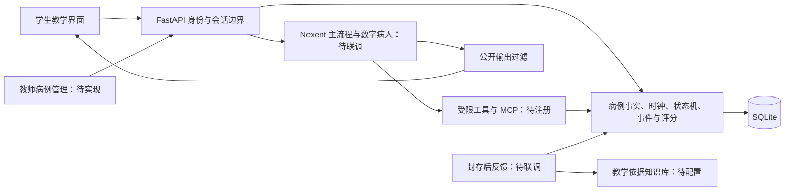

# 课题1启动技术方案

状态：开发计划。本地首例已实现，真实平台及完整交付待完成。AtomGit账号 `kechanghao`，GitHub账号 `kechanghao666`。

## 分工与边界

| 组成 | 职责与状态 |
|---|---|
| Nexent主智能体 | 真实编排及业务会话绑定，待联调 |
| 数字病人 | 只依据本轮获准事实回答；本地已实现，真实平台待联调 |
| 提交后反馈 | 依据封存事件给出五环节反馈；客观规则已有，平台反馈及知识库待接入 |
| 病例工具 | 受保护病例读取与版本；helper已有，教师新增/审核/发布待实现 |
| 状态工具 | 原子披露、检查订单、等待、治疗确认、演进；本地已有，MCP注册待完成 |
| 评分工具 | 冻结证据、分项评分和回放；本地已有，专家一致性待评测 |
| 知识资源 | 有来源和许可的指南摘要、术语、规则、评分依据，待整理与挂载 |

后端持有隐藏病例、状态、模拟时间、订单、幂等记录和冻结评分。问诊链不得获取完整病例、答案或未来演进；评分反馈与问诊隔离。工具组可以在一个服务按权限暴露，不额外引入第二套Agent框架。

模型、Nexent版本、实例和凭据未确认时，不宣称真实接入。完整病例与评分路径经专业审查后才可成为正式金标准；当前保持draft。

## 实施顺序

1. 确认目标Nexent版本、模型、会话协议，完成真实适配器、MCP注册和权限验证。
2. 跑通STEMI首例真实闭环，保留调用、状态、超时/断线/越权及封存反馈证据。
3. 完成正式身份、学生界面和教师病例新增/校验/审核/发布，再扩展5个不同专科。
4. 专业审查、真实学生/专家评测、时延与干净环境复现。
5. 平台导出、重新导入、视频与正式PR交付。

详细约束见根目录技术方案、实施规格及正式产品要求；评测和时间见 `acceptance-plan.md`、`milestones.md`。以上为计划，不能全部标为已实现。
