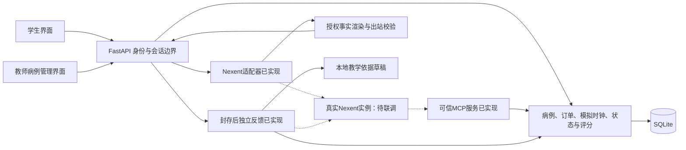

# 技术方案

## 目标与当前范围

建设AI数字病人临床思维训练系统，覆盖学生问诊、检查与回报、病历、鉴别诊断、诊断、治疗、分项反馈和回放，以及教师病例管理。最终至少包含5个不同专科病例；语音是可选功能，当前不实施。

当前有五个自造draft病例的本地工程闭环。学生与教师页面曾完成本地浏览器检查；2026-11-09环境恢复后，完整浏览器人工复验仍待完成。Nexent适配器、可信MCP服务、反馈链和教学依据库已实现并通过本地契约测试，但**尚未在真实Nexent实例上验证**；正式身份、医学审核和正式评测待完成。设计目标与运行能力分别验证，详见[Nexent集成](nexent-integration.md)。

## 架构与职责

后端持有病例真值、owner/session/case/version、状态、时间、订单、事件和客观评分。Nexent承担真实问诊决策、工具编排及受限表达，不能仅作形式调用。问诊链与封存反馈链隔离。

复用现有FastAPI、Streamlit、Pydantic和SQLite，不引入第二套Agent框架。实际依赖版本以锁文件为准；Nexent版本、模型和传输协议在目标环境核实后固定。

## 数据与安全边界

1. 病例为结构化文件；校验字段、唯一标识、事实/检查/规则引用和结果合法值。医学审查前保持draft，不虚构审核者、日期或正式金标准。
2. 学生只获取公开投影。隐藏病例、参考答案、未来分支、内部工具上下文不得进入学生响应或学生问诊检索库；公开病例编号不得暗示诊断。
3. 披露以本轮问题和当前有效事实授权；未配置、未开单、待回报、失败不等于正常。业务阶段、生理状态、模拟时间和订单状态分别记录。
4. 处置计划与确认执行分离。事件幂等并持久化；同请求ID不同内容拒绝，网络不确定时原请求重放。SQLite使用state_version条件更新，冲突不静默覆盖。
5. 封存统一冻结事件截止点与评分快照，所有入口拒绝封存后的新写入。合法旧请求重放仅返回原结果；病历补写不得伪造早期证据。
6. 病情变化必须有适用规则、公开说明和事件引用；学生实际获知的变化与内部状态一致，不只更改隐藏状态。
7. MCP按已验证会话从后端读取事实、允许集合及评分状态，不接受模型自报身份或权威数据。验证上下文清理、并发隔离、越权、评分权限及幂等。
8. 仅使用自造或脱敏数据，记录来源和许可；正式身份与教师角色实现前，不将开发身份模式对外公开。

## 真实平台集成

- 确认实例、稳定版本/提交、部署资源、模型、会话与流式协议；已有环境变量不是接入完成证据。凭据仅保存在服务端受保护配置，不写入仓库或日志。
- 实现Nexent适配器、可调用MCP、问诊编排和封存反馈，挂载具有来源与许可的教学依据。
- 当前回答门禁只接受获准事实原文拼接。先验证模型参与受限事实选择/工具编排、后端校验呈现；允许自然改写前另验事实一致性和防泄露，不直接删除门禁。
- 处理取消、超时、断线及重试，失败不得登记未完成操作；保留脱敏请求、响应和状态顺序，验证一次真实完整闭环及工具调用。

本地客户端现用可取消的异步连接/读取及统一截止，外部同步适配器契约不变；停止清理复用客户端并占用同一总预算，不用后台线程继续读流。平台首事件、最终文本、安全校验完成和前端接收耗时分别记录；这些局部计时不等于浏览器实际首字。具体配置、预留预算及边界见[Nexent集成](nexent-integration.md)。五专科专业前提和时间轴另见[候选决策审查表](clinical-decision-review.md)，未确认的医学规则不作为已实现能力。
- 从平台实际导出配置，并在干净实例重新导入；草案不冒充可导入agent.json。

## 多专科与评分扩展

诊断判定（名称与整句模板）、允许处置及触发锚点、延误规则的锚点检查与取消处置、鉴别证据规则、前端选项已改为有限病例配置，并有结构校验和教学安全校验；不建立通用规则语言。证据类型限定为已实现的五种，事实内容非空；当前仅支持显式开单，precondition及latest_workflow只接受空值，延迟规则须有已配置检查锚点，即时规则的anchor_event须等于本病例治疗trigger，且不能配置delay_exclusion_treatments。取消选择器仅接受动作名、治疗ID/trigger或规则ID；治疗选择器仅匹配executed为真的execute_treatment，显式plan_treatment可匹配计划动作。通用exclusions同时作用于即时和延误规则；既有delay_exclusion_treatments继续仅按执行取消。空白trigger、动作名遮蔽、规则与治疗重名及跨治疗ID/trigger歧义均拒绝。共享模型覆盖加载、保存、校验及状态转换，不新增规则表达式语言；同一事实/检查不得同时配置为同一候选的支持与反对依据。disclosure_level与auto_volunteer为编写元数据，不主动披露未问事实。STEMI-001 v1因已有会话固定而保持原文件，其旧行为由`legacy.py`补齐，新行为见v2。

已验证非心内科病例并扩展到五个专科。教师页面与接口覆盖导入、编辑、校验、保存、送审与发布；每次保存产生新草稿版本，历史训练引用的内容固定。MCP读取并刷新教师病例目录。真实身份服务未完成，开发模式以`teacher-`前缀身份代替，禁止据此公开部署。

按病史采集、检查选择、鉴别诊断、诊断、治疗五环节评分。证据仅来自本会话封存前已实际可用的事件；开单不等于已获得结果。鉴别文字先匹配具体事实或检查，再按配置判断支持/反对；未配置规则或文字无法对应时保留人工复核。评分快照带改进建议及事件引用；学生展示过滤建议中的参考诊断，保留原分数与历史快照。检查优先级由病例显式规则判定。各规则均标注未经医学审核，不能作为正式成绩。

本轮已修复标点/过短及混合方向证据误判、无效引用静默成功、立即回报结果未计证据和治疗演进未公开。自动匹配仅接受可定位的原文或足够明确的原文片段，不理解自由改写；含糊或多义文字保留复核。夹带无效事件时，有效证据的暂计分保留，但hit为false、总状态为needs_review，不能当作最终满分。立即回报与等待回报的结果均可在学生事件中引用；治疗与等待触发均产生公开变化和事件证据，无新事实时使用规则的变化说明。来源展示已补齐，含参考答案的题名/来源会隐藏；教学依据仍为8条限STEMI、1条通用反馈规范，已按病例版本管理依据；其他四专科及教师复制病例的专业依据仍待补齐和审核；needs_review及complete争议评分的独立教师裁定已实现，见[开发计划](milestones.md)。

历史反馈和当前反馈均可通过 `/api/teacher/feedback/{session_id}` 复核：GET须提供学生owner_id，POST提交五环节items、原因、request_id、expected_revision及所选依据的basis_hashes；教师身份由后端解析，不接受客户端冒名。复核追加写入集成库的feedback_reviews，不修改feedback原件或sessions封存记录；事务和版本检查防止并发覆盖，请求摘要用于持久幂等。学生GET/POST反馈均选择最新复核版本，展示前仍运行同一安全校验，不公开内部原因或原件。教师也可为未生成反馈的封存训练提交第一版复核反馈。此接口仅处理文字和引用，不能修改分数、解除needs_review或宣称医学审核完成。

评分裁定使用独立的 `/api/teacher/scores/{session_id}` 接口，处理已封存且原规则分为needs_review或complete的训练，缺失/失败评分或未封存仍返回409。complete仅表示规则计算完成，允许教师在发现争议后填写具体原因并复核；页面显示真实原状态。请求须覆盖全部原评分项、严格确认、有限数值和原上限，正分须引用封存前真实事件，公开说明经过参考答案保护。集成库score_reviews追加记录完整裁定、教师、时间和内部原因；事务、请求摘要和expected_revision保障幂等及并发冲突。学生 `/api/sessions/{session_id}/score-review` 仅返回最新可公开快照，不暴露内部原因或教师身份。原 `/score`、封存状态及反馈保持原样，反馈仍基于原规则分。开发演示裁定不等于正式成绩或独立专家评测。

教学依据区分clinical与feedback_guidance；病例校验和教师页面显示五环节临床覆盖缺口，通用写作规范不填补专科缺项。学生反馈只接收覆盖状态和缺失环节，不接收完整内部依据ID清单。覆盖按病例ID及具体病例版本计算，有条目不表示医学审核通过；复制新ID或保存未列出的新版本不继承临床覆盖。manifest中的revision标明依据修订，applies_to_versions显式列出临床条目适用的病例版本；通用写作规范可以跨病例，但不计入临床覆盖。

新生成反馈和每次教师复核的完整引用快照存入集成库feedback_basis，与对应反馈/复核在同一事务提交，revision=0关联原始反馈，正整数关联教师复核。快照包含库版本、状态、病例ID/版本及每条依据的正文、来源、修订、适用范围和SHA256；哈希用于内容一致性核验，不是医学认证或防篡改签名。读取时仍检查当前条目适用性、五环节、安全规则及快照完整性，学生端只展示快照中安全的题名和来源，不展示正文或完整快照。撤下当前依据会阻止相应旧反馈向学生展示，历史快照仍留给教师核对。旧记录没有快照时标记legacy_unversioned，不补造历史依据。

教师编辑依据若在载入后改变，basis_hashes不匹配返回409并要求重新载入；已提交请求先按原请求摘要重放，不因知识升级重复保存。MCP提交反馈时附带服务端生成的快照，API与MCP快照不一致则拒绝保存，防止两个进程使用不同知识版本。

SQLite事务显式关闭连接，不依赖垃圾回收；保留版本冲突检查和封存约束。集成数据库与知识目录的相对配置统一以项目根目录解析，不随API/MCP启动位置变化。学生未保存病历返回前提供保存、继续编辑与明确放弃选项；动作切换和成功执行均清除治疗确认。账号/后端切换仍清理缓存，不将草稿跨身份保留。

每例冻结明显错误决策清单及实际适用的检查、延误、处置恶化分支，专业审查规则及阈值后验证触发和反馈。医学审查及独立留出评测是本项目质量措施，不伪称为官方逐字要求。

2026-11-08编写边界加固（N10/N11）：保存及加载统一拒绝不同病例的内部/公开编号交叉冲突；历史同病例版本和别名保留，自动公开编号避开两类已用编号。病例库完整校验后才替换缓存；MCP遇到非法库时取消回合、记录安全错误，不使用旧缓存继续回答。问诊评分事实校验患者知晓、current、归一化触发词及与非负模拟时钟相交的有效时间，送审时重新检查；合法非评分隐藏事实和未来有效窗口仍可使用。编号校验接口返回identifier_conflict，直接保存冲突继续409；不可问的问诊评分事实返回unreachable_rubric_fact，保存/生命周期校验422。这属于可执行性校验，不认证医学正确性。混合标识查找API及固定内部ID/版本引用保留；同病例历史公开别名继续解析其当前可用版本。PyArrow阻断是2026-11-08的历史环境问题；2026-11-09已在独立环境恢复依赖导入并通过服务健康检查，完整浏览器人工复验仍待完成，详见[测试说明](testing.md)。

## 产品与验证

学生页面以中文表达当前会话、提交结果、检查待返回、封存和评分状态；网络错误保留会话与待重放请求，恢复后回填本人提交内容，回放不泄露内部字段。未实现功能不展示为可用按钮。

医学审查、学生与教师评测人员提前安排；正式样本在病例、量表和代码版本冻结后采集。模拟回归、真实模型调用、专业审核和正式验收分别留证，不用测试数量替代达标结果。

实施顺序和外部节点见[开发计划](milestones.md)，量化指标与交付清单见[验收计划](acceptance-plan.md)。
