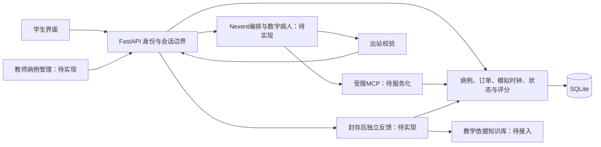

# 技术方案

## 目标与当前范围

建设AI数字病人临床思维训练系统，覆盖学生问诊、检查与回报、病历、鉴别诊断、诊断、治疗、分项反馈和回放，以及教师病例管理。最终至少包含5个不同专科病例；语音是可选功能，当前不实施。

当前仅实现自造STEMI草稿病例的本地工程闭环。真实Nexent适配器、MCP服务、知识库、正式身份和教师页面均待完成；设计目标与运行能力分别验证。

## 架构与职责

后端持有病例真值、owner/session/case/version、状态、时间、订单、事件和客观评分。Nexent承担真实问诊决策、工具编排及受限表达，不能仅作形式调用。问诊链与封存反馈链隔离。

复用现有FastAPI、Streamlit、Pydantic和SQLite，不引入第二套Agent框架。实际依赖版本以锁文件为准；Nexent版本、模型和传输协议在目标环境核实后固定。

## 数据与安全边界

1. 病例为结构化文件；校验字段、唯一标识、事实/检查/规则引用和结果合法值。医学审查前保持draft，不虚构审核者、日期或正式金标准。
2. 学生只获取公开投影。隐藏病例、参考答案、未来分支、内部工具上下文不得进入学生响应或学生问诊检索库；公开病例编号不得暗示诊断。
3. 披露以本轮问题和当前有效事实授权；未配置、未开单、待回报、失败不等于正常。业务阶段、生理状态、模拟时间和订单状态分别记录。
4. 处置计划与确认执行分离。事件幂等并持久化；同请求ID不同内容拒绝，网络不确定时原请求重放。SQLite使用state_version条件更新，冲突不静默覆盖。
5. 封存统一冻结事件截止点与评分快照，所有入口拒绝封存后的新写入。合法旧请求重放仅返回原结果；病历补写不得伪造早期证据。
6. 病情变化必须有适用规则、公开说明和事件引用；学生实际获知的变化与内部状态一致，不只更改隐藏状态。
7. MCP按已验证会话从后端读取事实、允许集合及评分状态，不接受模型自报身份或权威数据。验证上下文清理、并发隔离、越权、评分权限及幂等。
8. 仅使用自造或脱敏数据，记录来源和许可；正式身份与教师角色实现前，不将开发身份模式对外公开。

## 真实平台集成

- 确认实例、稳定版本/提交、部署资源、模型、会话与流式协议；已有环境变量不是接入完成证据。凭据仅保存在服务端受保护配置，不写入仓库或日志。
- 实现Nexent适配器、可调用MCP、问诊编排和封存反馈，挂载具有来源与许可的教学依据。
- 当前回答门禁只接受获准事实原文拼接。先验证模型参与受限事实选择/工具编排、后端校验呈现；允许自然改写前另验事实一致性和防泄露，不直接删除门禁。
- 处理取消、超时、断线及重试，失败不得登记未完成操作；保留脱敏请求、响应和状态顺序，验证一次真实完整闭环及工具调用。
- 从平台实际导出配置，并在干净实例重新导入；草案不冒充可导入agent.json。

## 多专科与评分扩展

现有诊断匹配只处理STEMI，治疗执行只支持aspirin/reperfusion_pathway，延误演进绑定ex_ecg及再灌注，前端选项也为首例固定值。须将所需诊断判定、允许处置、触发及排除条件改为有限、可审查的病例配置，同步校验、调用方、前端选项和回归测试；未知输入继续拒绝，不建立通用规则语言。

先验证一个非心内科病例，再扩展其余专科。教师端实现身份/角色、新增、校验、保存、审核/发布与版本固定；已有工具helper不等于教师产品已完成。

按病史采集、检查选择、鉴别诊断、诊断、治疗五环节评分。证据仅来自本会话封存前已实际可用的事件；开单不等于已获得结果。当前鉴别项主要进入needs_review，须实现支持/反对证据的病例规则或受约束评分，并提供扣分、改进建议及事件引用。不确定文本保留复核，不靠查词默认判对；检查优先级由病例显式规则判定。

每例冻结明显错误决策清单及实际适用的检查、延误、处置恶化分支，专业审查规则及阈值后验证触发和反馈。医学审查及独立留出评测是本项目质量措施，不伪称为官方逐字要求。

## 产品与验证

学生页面以中文表达当前会话、提交结果、检查待返回、封存和评分状态；网络错误保留会话与待重放请求，恢复后回填本人提交内容，回放不泄露内部字段。未实现功能不展示为可用按钮。

医学审查、学生与教师评测人员提前安排；正式样本在病例、量表和代码版本冻结后采集。模拟回归、真实模型调用、专业审核和正式验收分别留证，不用测试数量替代达标结果。

实施顺序和外部节点见[开发计划](milestones.md)，量化指标与交付清单见[验收计划](acceptance-plan.md)。
