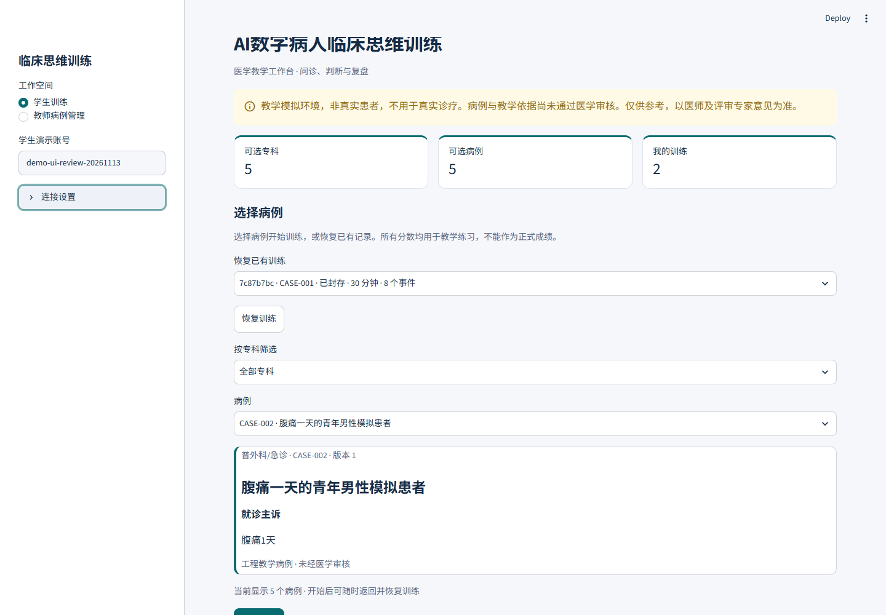
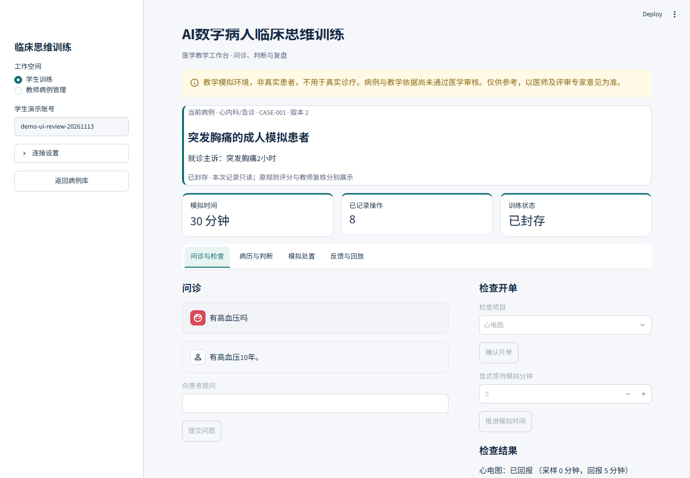
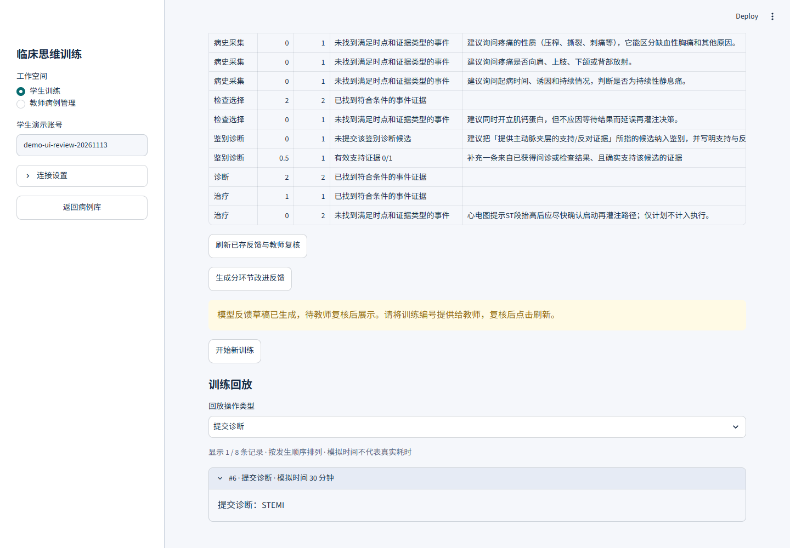
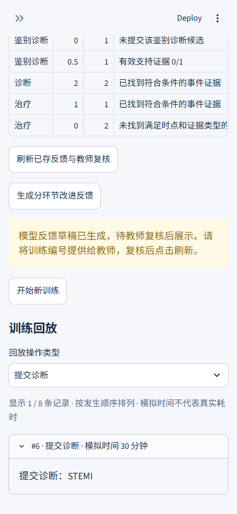
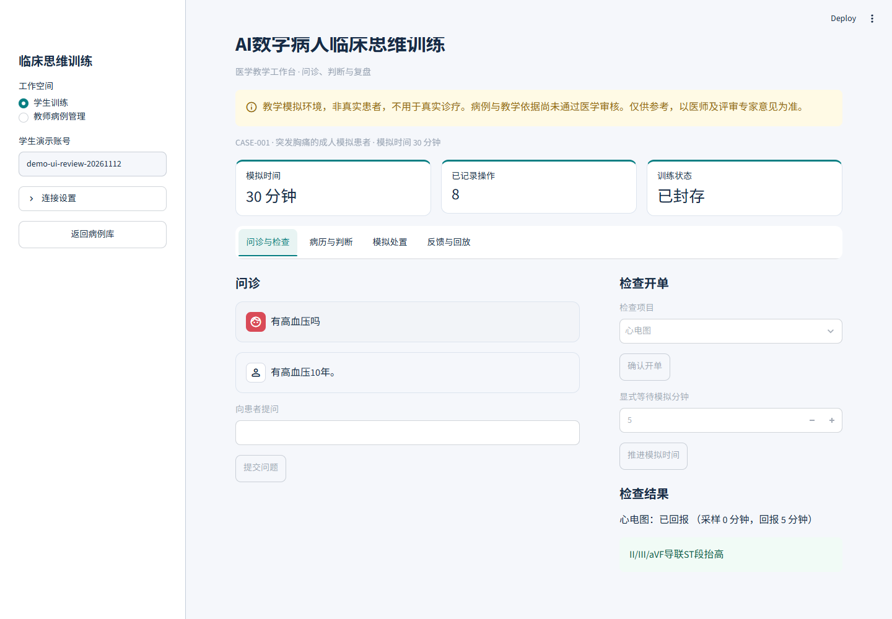
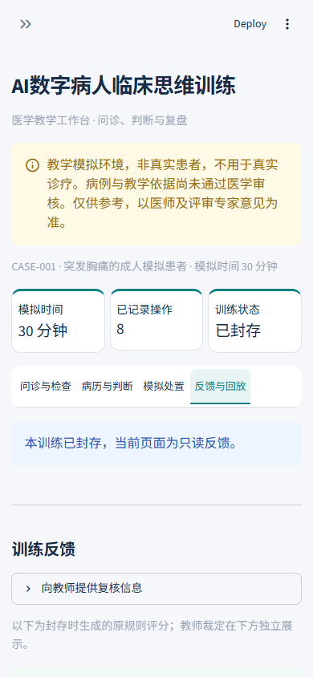

# 训练工作台与界面验证

## 2026-11-13 当前界面

已先完成工程复盘和官方要求核对，再研究六个官方设计/无障碍来源并实施升级；[调研与设计决定](ui-design-research.md)记录来源、采用方式及未覆盖项。当前新增按专科筛选、公开病例信息卡，以及保留原编号的筛选/展开式回放；主要动作、焦点、文字对比和320px页签重排同步完善。

480项回归、十二组工程样本及真实Edge流程验证通过。浏览器实际回答17.547秒，仍未达到5秒；教师只读取原件，没有保存审批。截图均为合成教学训练。完整验证及脚本适配记录见[本轮证据](evidence/2026-11-13-ui-upgrade.json)；未执行完整人工无障碍、医学审核和正式人员验收。以下保留此前设计记录。

2026-11-12。沿用Streamlit原生控件、现有主题与接口，没有引入前端框架或新生产依赖。使用海军蓝正文、青绿色操作与白色内容区，压缩宣传占位，保留醒目的教学模拟和待医学审核提示。

| 入口 | 用途 |
| --- | --- |
| 问诊与检查 | 左侧患者对话，右侧开单、显式推进时间和检查回报 |
| 病历与判断 | 保存病历、填写鉴别证据与引用、提交诊断 |
| 模拟处置 | 明确确认后执行；病历未保存时不能封存 |
| 反馈与回放 | 封存后评分和经复核的反馈；训练中可回放已记录操作 |
| 教师反馈复核 | 评分表、学生病历/诊断、事件清单；完整证据与原件保留 |

页签切换不卸载输入。每次训练及封存状态有独立导航标识，防止旧页签导致封存后仍停在处置页。病情变化显示在所有页签上方。封存、断线只读、身份隔离、教师权限和模型草稿展示限制沿用现有实现。

浏览器验证覆盖连续真实模型流程、输入保持、封存前保护、键盘页签、390px导航及只读原件。截图来自合成训练，分数不代表正式成绩。没有执行真实教师批准；全量工程回归不等于全面人工无障碍、医学审核或正式人员验收。实际结果及失败尝试见[证据](evidence/2026-11-12-ui-workspace.json)。
