# 训练工作台与界面验证

> 2026-11-13 内容比例调整：登录内容最大宽度由1200px扩大至1560px，标题、光环、输入框与正文放大；增加三阶段训练说明，保留无卡片构图。已检查1920/1366/768/390/320px；1366×768登录按钮位于首屏，手机连接设置完整显示；学生/教师登录、退出与光标响应复验通过。

> 2026-11-13 后续调整：按用户要求移除登录页和工作区的动态背景开关，动效始终默认开启，仍遵循系统减少动态效果设置。16 项相关测试通过；运行中的 8508 页面已验证无开关、光环持续运动且响应光标。下方提及页面暂停开关的内容为此前版本记录。

> 2026-11-13 启用更新：用户已授权并启动独立账号预览（本机 8508，API 8006）。学生、教师实际浏览器登录/退出、后端角色权限与退出令牌失效均已验证；问诊使用本地模拟。自动打开浏览器和账号文件被策略拦截，可手动访问。见[运行证据](evidence/2026-11-13-account-preview-live.json)。下方“待确认/旧后台尚未启用”等为启动前记录。

## 当前本地版本：光标交互与账号入口

原创光环持续流动，并响应鼠标位置；配有跟随光晕、暂停与减少动态效果支持。独立账号的登录页已完成，账号后台通过测试，当前旧预览后台尚未启用；图中明确禁用登录，避免将外观当作已上线认证。

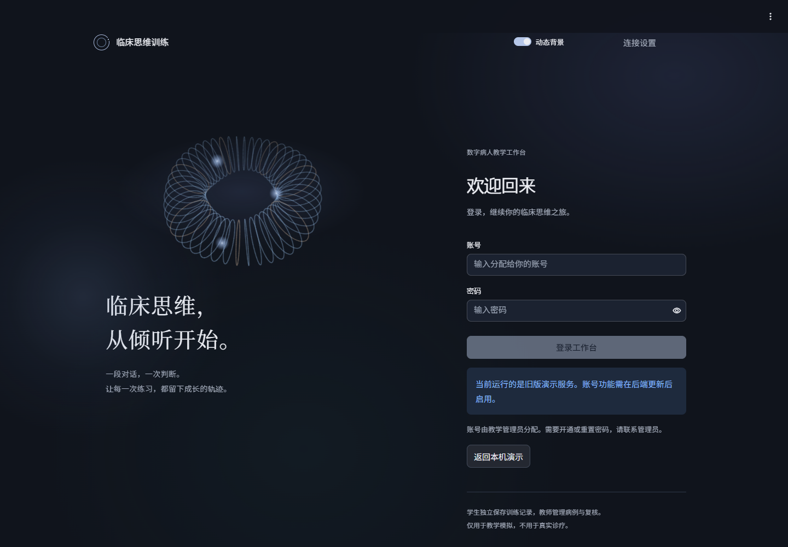

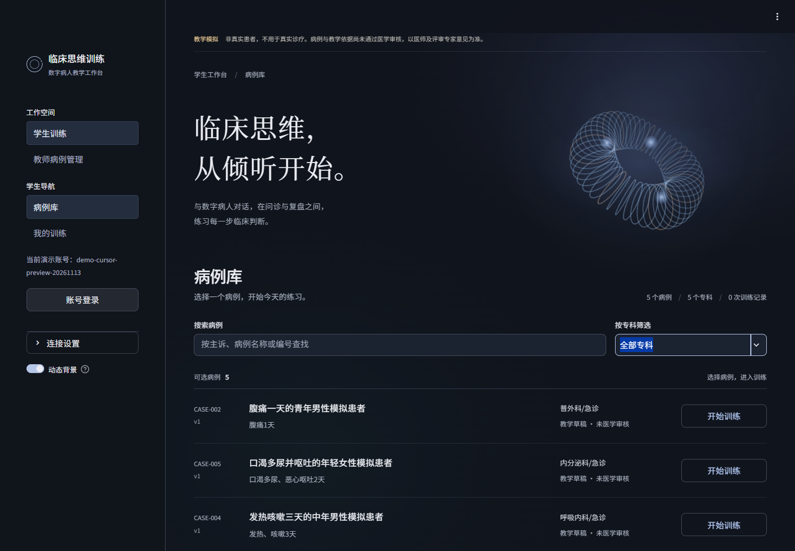

[9秒光标交互录像](evidence/cursor-accounts-20261113/cursor-motion.mp4)

完整回归 488 项通过，后续账号检查 6 项通过；浏览器动效、暂停和 390/320px 检查通过。见[设计说明](cursor-interaction-design.md)和[账号说明](local-accounts.md)。下方为历史版本。

## 历史：光影与中文字体

本轮实际查看Claude、ElevenLabs和Cursor首页后，重做字体层级、留白与原创动态光环；保留可搜索病例列表。侧栏可以暂停背景，系统减少动态效果设置会自动停止动画。字体与图形本地交付。

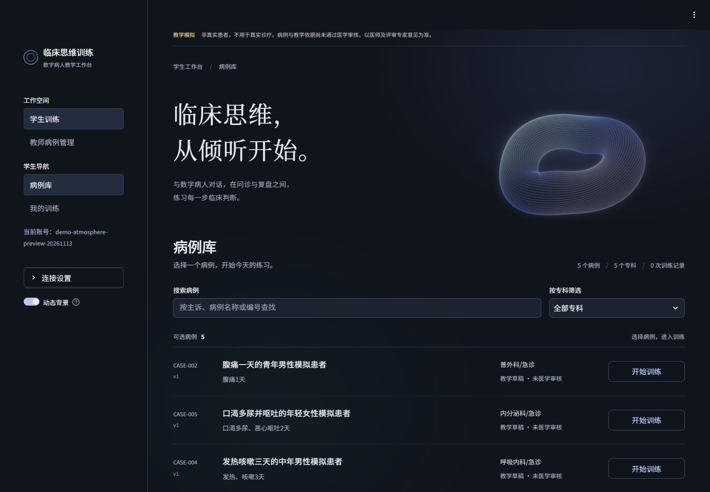

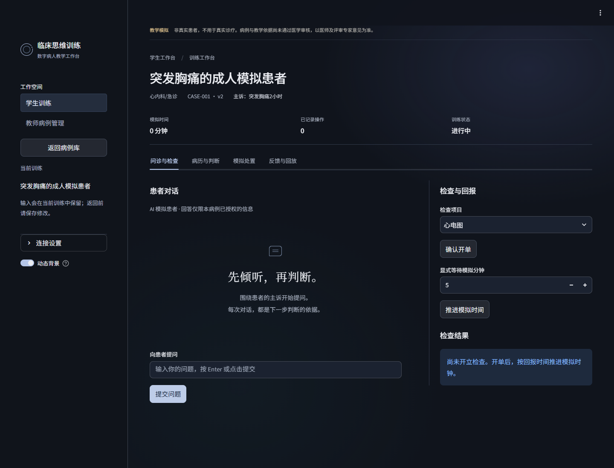

[8秒实际动态录屏](evidence/atmosphere-ui-20261113/workspace-motion.mp4)

94项相关检查、真实浏览器的动效/字体/移动布局/已有训练及教师复核页面验证通过；原业务库不变，未写入教师批准。尚未发布远端，也不代表用户已认可视觉效果。见[设计研究](atmosphere-ui-design.md)及[本轮证据](evidence/2026-11-13-atmosphere-ui.json)。下方为历史版本。

## 历史：深色列表工作区（用户要求继续提升）

根据用户明确选择重新设计。病例库为连续列表，训练页为一张分栏工作画布；导航与表单沿用原生操作，老师复核表单紧凑排列。[研究、设计提示词与取舍](dark-workspace-design.md)记录九个官方来源和本次实际决定。

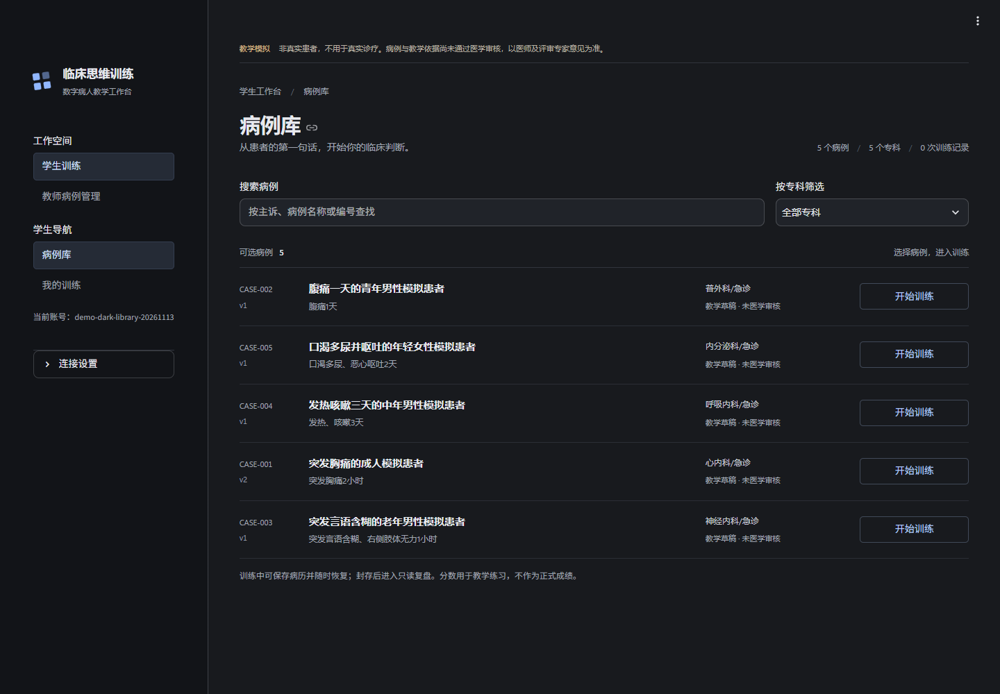

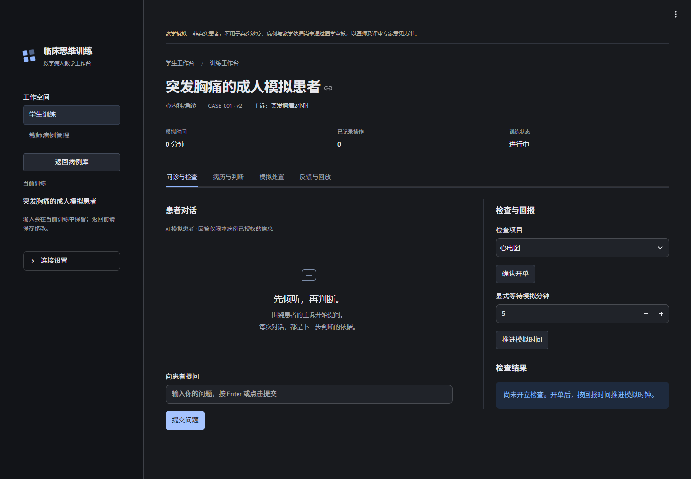

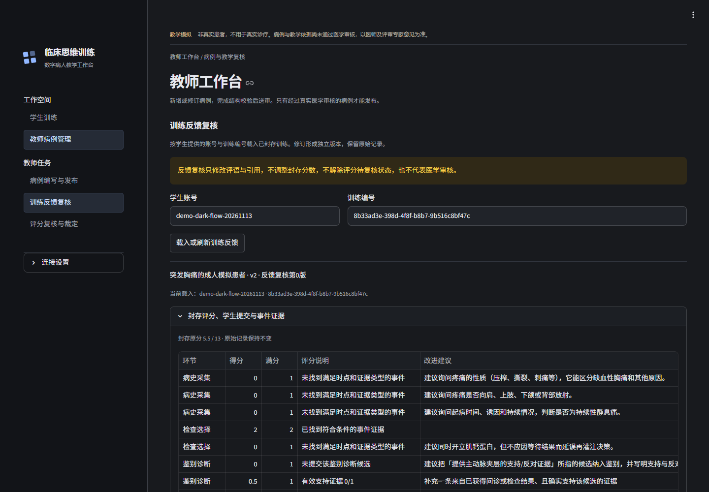

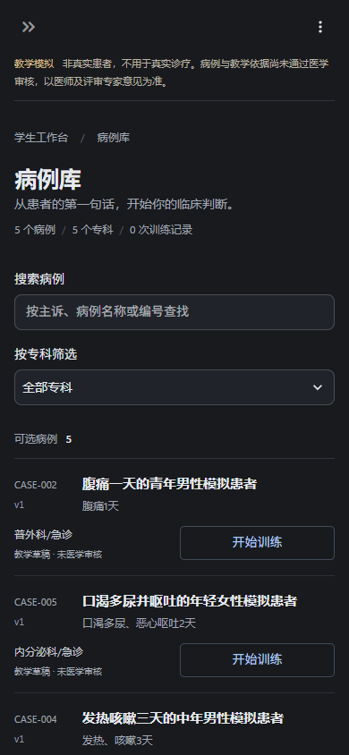

本地已运行于8506，连接隔离API8005；界面可在连接设置修改API和演示账号。自动检查93项通过，浏览器实际完成合成训练与教师只读复核；原业务库未改动。本轮响应6.015秒，仍超5秒。未发布远端，未取得用户审美认可、真实医学审核或完整无障碍验收。详见[验证证据](evidence/2026-11-13-dark-workspace.json)。以下仅保留历史截图，不代表当前设计。

## 历史：浅色卡片工作台（已被用户否定）

2026-11-13，完成[主流AI平台与生产力软件设计研究](platform-design-study.md)后重构。侧栏区分工作空间和实际任务；病例库采用搜索卡片，“我的训练”按真实记录恢复。训练页使用紧凑病例栏，问诊与检查、病历与判断分别并排；处置和封存分区；复盘先看总分和五环节摘要，再展开逐项依据。具体实现与限制见[本轮验证](evidence/2026-11-13-design-rebuild.json)。

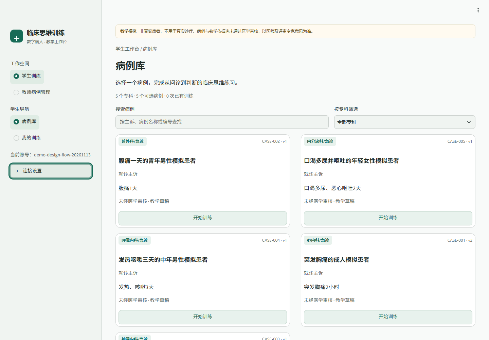

运行地址以当前启动参数为准；本机本轮预览为8506，连接隔离API 8005。新环境默认API 8000，可在启动前设置FRONTEND_API_URL或在连接设置修改。截图均为合成教学训练，模型反馈未写入教师批准。

482项全量测试通过，真实浏览器完整流程、历史恢复、搜索空状态、390/320px检查通过；回答可见6.015秒，仍超5秒目标。未完成真人可用性和完整读屏审核。以下保留之前界面的历史截图。

## 历史：2026-11-13 第一版界面

已先完成工程复盘和官方要求核对，再研究六个官方设计/无障碍来源并实施升级；[调研与设计决定](ui-design-research.md)记录来源、采用方式及未覆盖项。当前新增按专科筛选、公开病例信息卡，以及保留原编号的筛选/展开式回放；主要动作、焦点、文字对比和320px页签重排同步完善。

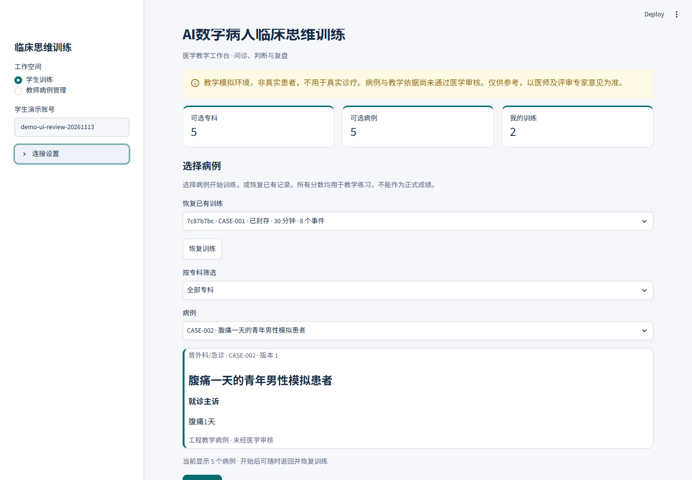

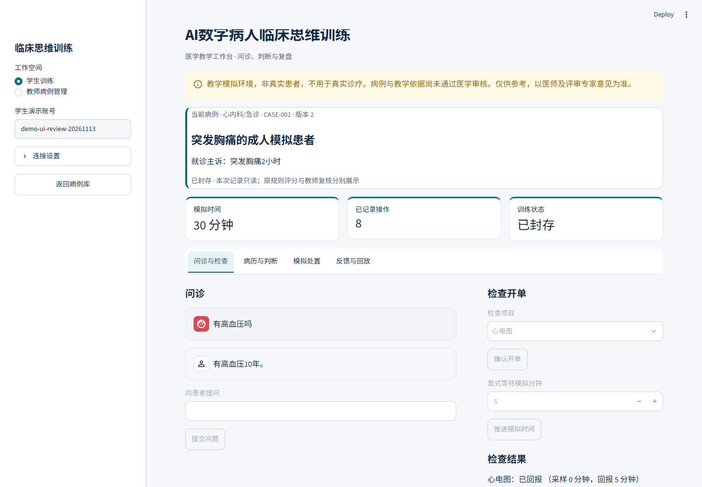

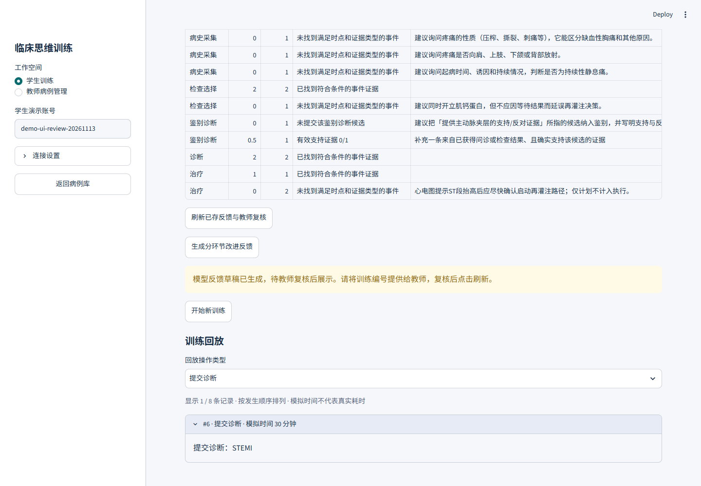

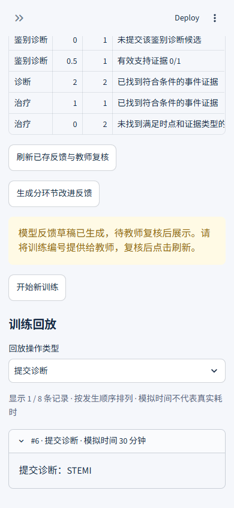

480项回归、十二组工程样本及真实Edge流程验证通过。浏览器实际回答17.547秒，仍未达到5秒；教师只读取原件，没有保存审批。截图均为合成教学训练。完整验证及脚本适配记录见[本轮证据](evidence/2026-11-13-ui-upgrade.json)；未执行完整人工无障碍、医学审核和正式人员验收。以下保留此前设计记录。

2026-11-12。沿用Streamlit原生控件、现有主题与接口，没有引入前端框架或新生产依赖。使用海军蓝正文、青绿色操作与白色内容区，压缩宣传占位，保留醒目的教学模拟和待医学审核提示。

| 入口 | 用途 |
| --- | --- |
| 问诊与检查 | 左侧患者对话，右侧开单、显式推进时间和检查回报 |
| 病历与判断 | 保存病历、填写鉴别证据与引用、提交诊断 |
| 模拟处置 | 明确确认后执行；病历未保存时不能封存 |
| 反馈与回放 | 封存后评分和经复核的反馈；训练中可回放已记录操作 |
| 教师反馈复核 | 评分表、学生病历/诊断、事件清单；完整证据与原件保留 |

页签切换不卸载输入。每次训练及封存状态有独立导航标识，防止旧页签导致封存后仍停在处置页。病情变化显示在所有页签上方。封存、断线只读、身份隔离、教师权限和模型草稿展示限制沿用现有实现。

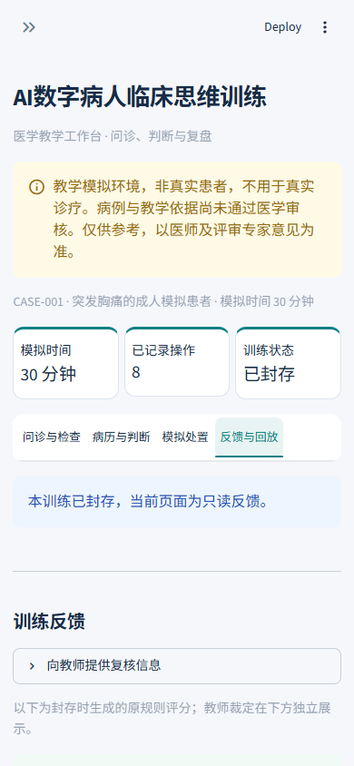

浏览器验证覆盖连续真实模型流程、输入保持、封存前保护、键盘页签、390px导航及只读原件。截图来自合成训练，分数不代表正式成绩。没有执行真实教师批准；全量工程回归不等于全面人工无障碍、医学审核或正式人员验收。实际结果及失败尝试见[证据](evidence/2026-11-12-ui-workspace.json)。
